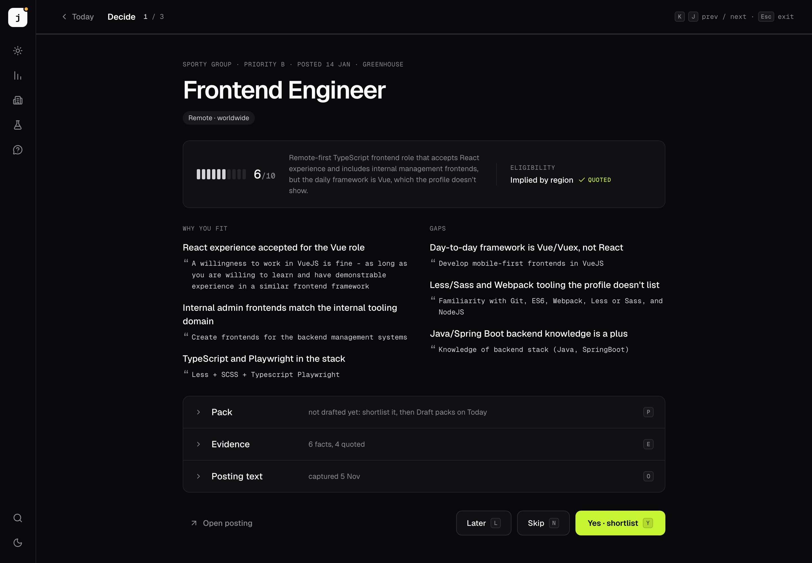
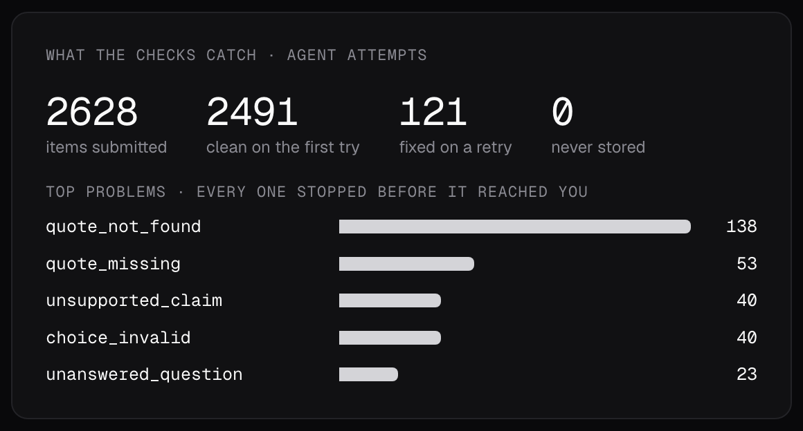
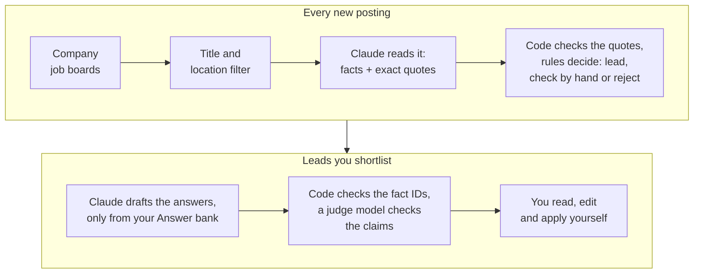
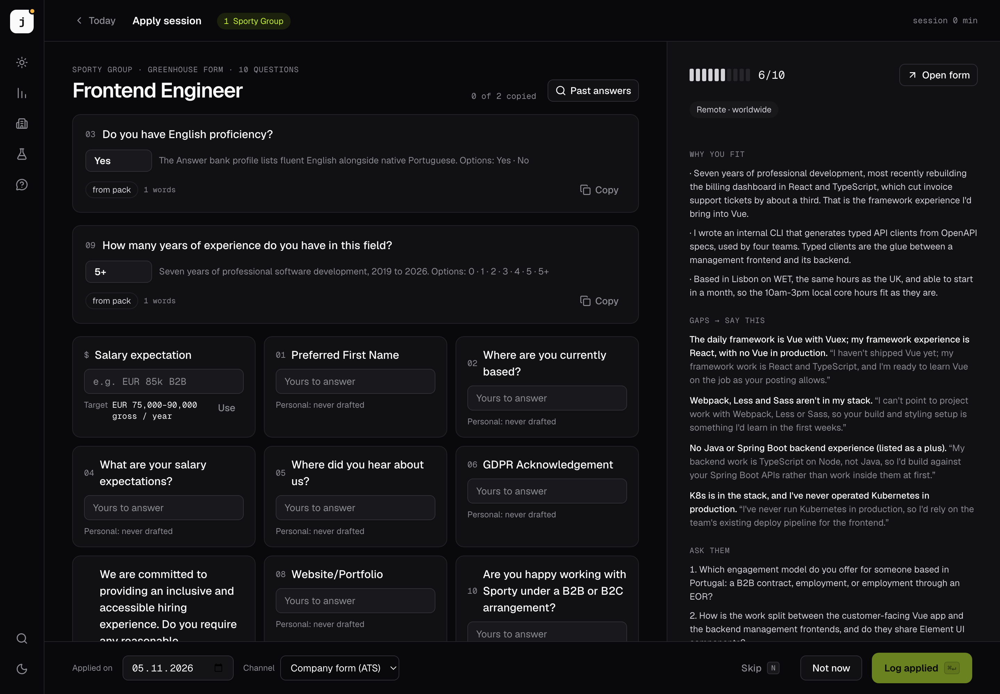
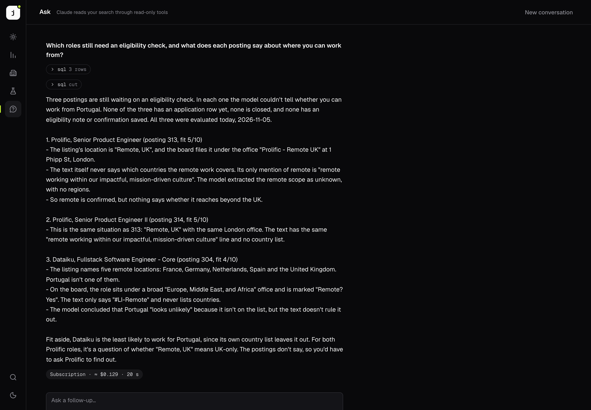

# llm-job-search

[](https://github.com/vladakopejsek/llm-job-search/actions/workflows/check.yml)

An LLM pipeline that reads job postings for you. Claude pulls out the facts with exact quotes, code checks them and makes the decision, and drafts for application forms use only facts you wrote down. It never applies on its own.



*Focus: one lead at a time, why it fits and what's missing, each with its quote. The screenshots come from a demo database with a fictional candidate, apart from the checks card.*

## Highlights

- **Reads the boards you watch.** Ten job-board APIs (Ashby, Greenhouse, Lever, Workable, Workday and five more), plus a search of public job boards for new companies.
- **The model reads, the code decides.** Claude returns facts in a fixed JSON schema, each with a quote. Code checks every quote against the posting, and [plain rules](packages/core/src/agent/rules.ts) make the verdict.
- **Drafts only from your facts.** Every claim in a drafted answer cites a fact in your Answer bank. Code rejects anything else, and a second model checks what each claim says.
- **Ask questions about your search.** Claude answers with six read-only tools over the database, and every tool call is shown.
- **Models picked by evals.** Each model choice was [tested](docs/evals.md) against real decisions before it went in.
- **Runs on the API or a Claude subscription**, with the same prompts and checks. It switches by itself when the API credit runs out.
- **Never applies on its own.** No code submits a form or sends an email.

## Quick start

You need Node 24, pnpm, Postgres, and an Anthropic API key or a Claude subscription.

```sh
pnpm install
cp .env.example .env                               # database URLs, API key
mkdir -p data
cp seeds/answer-bank.example.md data/answer-bank.md
cp seeds/pay.example.md data/pay.md
cp seeds/search.example.json data/search.json
pnpm db:migrate
pnpm import:watchlist seeds/demo-companies.json    # a few companies to watch
pnpm collect                                       # read their job boards
pnpm daily-run --skip-collect --evaluations 5      # Claude reads 5 postings
pnpm queue                                         # open the app
```

`data/` holds your own files and stays out of git: `answer-bank.md` (facts about you), `pay.md` (pay targets) and `search.json` (where you live, the cities you'd go to an office in, the languages you speak). The seeds describe a fictional candidate in Lisbon.

To run it every day, schedule `pnpm collect` and `pnpm daily-run`, with cron or similar.

## Results

Measured on real use. The details are in [docs/evals.md](docs/evals.md).

| | |
|---|---|
| **Model choice** | On 164 postings with a human decision, Sonnet 5.5 decided as well as Opus 5.5 for under half the price ($0.96 vs $2.12 per 75 postings). Haiku 5.5 dropped one wanted job in five. |
| **Checks** | Of 2,626 model submissions, 95% passed every check the first time. The checks stopped 351 errors, 138 of them quotes that weren't in the posting. |
| **Judge** | A Haiku 5.5 judge caught 93% of false claims planted in drafts, for less than a tenth of a cent per check. |
| **Cost** | About $0.04 per posting read and $0.45 per drafted application. |



## How it works



A collect reads every watched board and stores the new postings that pass the title and location rules. Claude reads each one into a fixed schema, with a quote for every fact. Code checks the quotes and decides. You go through the leads in Focus, and for the ones you shortlist, Claude drafts the form answers from your Answer bank. Code and a judge model check every claim before you see the draft. [docs/design.md](docs/design.md) explains each part and why it's built that way.

## Screenshots

| The apply session | Ask |
|---|---|
|  |  |

## Docs

- [Design](docs/design.md): how it works and why.
- [Evals](docs/evals.md): how the models were chosen, with results.
- [Metrics](docs/metrics.md): what the app measures about itself, and how.
- [API runner](docs/api-runner.md): the TypeScript runner on the Anthropic API, and Ask.

## Limitations

It's built for a TypeScript web engineer living in Europe. Where you live is configuration; the stack rules are code, in [`screen/rules.ts`](packages/core/src/screen/rules.ts) and [`agent/rules.ts`](packages/core/src/agent/rules.ts).

## License

MIT. Finding new companies uses the daily snapshot from [job-board-aggregator](https://github.com/Feashliaa/job-board-aggregator) (code MIT, data CC BY-NC). This project reads the snapshot and doesn't share it further.

Built by Vladimír Kopejska to learn LLM engineering properly, and used on real job postings.
